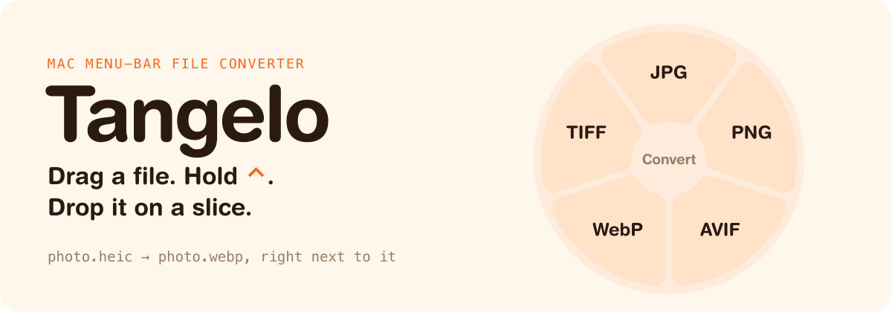
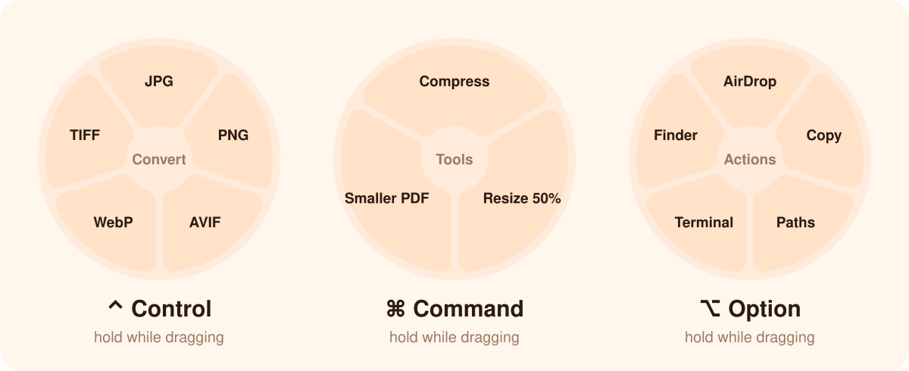
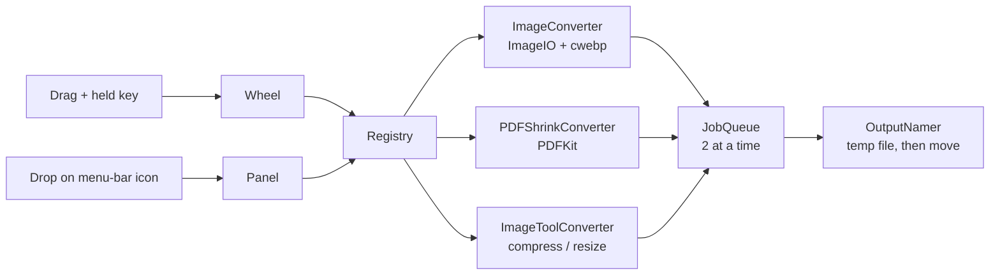

<p align="center">
  
</p>

<p align="center">
  <a href="https://github.com/esoteric-frog/Tangelo/actions/workflows/ci.yml"></a>
  
  
  <a href="https://github.com/esoteric-frog/Tangelo/releases/latest"></a>
  <a href="LICENSE"></a>
</p>

<p align="center">
  <b>Tangelo is a tiny Mac menu-bar app that converts files where you drag them.</b><br>
  No window to open, no upload, no settings. The new file lands next to the old one.
</p>

<p align="center">
  <a href="https://esoteric-frog.github.io/Tangelo/"></a>
</p>

---

## Try it first

No Mac needed. The [**try-it page**](https://esoteric-frog.github.io/Tangelo/) has a sample photo. Drag it, hold <kbd>⌃</kbd>, and drop it on a slice. You get a real converted file to download. You can use your own image too, and it never leaves your browser. On a phone, tap the photo, then tap a key button.

## Three wheels, one per key

Start dragging any file, from Finder or any app. Hold one key and a wheel opens right under the pointer. Let go of the file on a slice.

<p align="center">
  
</p>

| Hold | Wheel | What is on it |
| :---: | --- | --- |
| <kbd>⌃</kbd> | **Convert** | JPG · PNG · TIFF · HEIC · AVIF · WebP, and Smaller PDF |
| <kbd>⌘</kbd> | **Tools** | Compress · Resize 50% · Smaller PDF |
| <kbd>⌥</kbd> | **Actions** | AirDrop · Copy Files · Copy Paths · Open in Terminal · Show in Finder |

The wheel only shows choices that work for **every** file you are dragging. Drop in the middle, or anywhere off the wheel, and nothing happens.

Prefer clicking? Drop files on the menu-bar icon, or click it and choose **Choose Files…**.

## What it reads

| In | Out |
| --- | --- |
| HEIC, JPEG, PNG, TIFF, WebP, AVIF, GIF, BMP | JPG, PNG, TIFF, HEIC, AVIF, WebP |
| PDF | a smaller PDF (kept only if it really is smaller) |

## Small promises

- **Never overwrites.** `photo.heic` becomes `photo.jpg`. If that name is taken, you get `photo 2.jpg`.
- **No half files.** Tangelo writes to a temp file, then moves it into place. A failed job leaves nothing behind.
- **Nothing leaves your Mac.** Images use Apple's own ImageIO and PDFKit. WebP uses Google's `cwebp`, which ships inside the app.
- **No permissions to grant.** Tangelo sees drags by watching the mouse and the drag pasteboard, so it does not need Accessibility access.

## Install

You need macOS 14 or later on Apple silicon, and the Swift 6 toolchain (Xcode or just the Command Line Tools: `xcode-select --install`).

```bash
git clone https://github.com/esoteric-frog/Tangelo.git
cd Tangelo
scripts/install.sh      # builds, copies to /Applications, starts it
```

Tangelo adds itself to Login Items the first time it runs from `/Applications`.

<details>
<summary><b>Using the release download instead</b></summary>

The app on the [Releases](https://github.com/esoteric-frog/Tangelo/releases) page is ad-hoc signed, not notarized. macOS will block it the first time. After you move it to `/Applications`, run:

```bash
xattr -dr com.apple.quarantine /Applications/Tangelo.app
```
</details>

## Build and test

```bash
scripts/test.sh         # swift test (works without full Xcode)
scripts/make-app.sh     # builds build/Tangelo.app, ad-hoc signed
```

`scripts/fetch-tools.sh` downloads `cwebp` from Google and checks its SHA-256 before use.

<details>
<summary><b>How it fits together</b></summary>



- `Sources/TangeloCore` holds the logic and has no UI, so all of it is under test.
- `Sources/Tangelo` is the menu-bar app: the drag watcher, the wheel and the panel.
- A new format is one new `Converter`. The wheel and panel do not change.
</details>

## Coming next

- [ ] Video and audio (bundled `ffmpeg`)
- [ ] Documents: Word, Pages, EPUB, PowerPoint
- [ ] Strip photo metadata, read QR codes
- [ ] A floating shelf that holds files for later

## License

[MIT](LICENSE). `cwebp` is BSD 3-Clause; its notice ships in `Tangelo.app/Contents/Resources/licenses/`.

<p align="center"></p>
